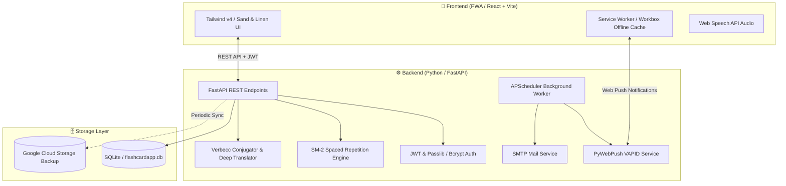

# 🗂️ FlashCardApp (PWA)

[](https://fastapi.tiangolo.com)
[](https://react.dev)
[](https://www.typescriptlang.org)
[](https://vitejs.dev)
[](https://tailwindcss.com)
[](https://web.dev/progressive-web-apps/)
[](LICENSE)

**FlashCardApp** is a modern, bilingual (**Spanish / English**) Progressive Web App (PWA) designed for language learners to master vocabulary and phrases in context (*chunking*). Built with an organic, tactile **Sand / Linen** aesthetic (`#FAF8F5`, `#2C2621`, `#C86D51`), the app delivers a native-feeling experience optimized for **iOS Safari** ("Add to Home Screen"), **Android Chrome**, and **Desktop** browsers.

---

## 🌟 Key Features

### ⚡ Smart Capture & Real-Time Anti-Duplicate System
- **Real-Time Duplicate Checking:** Debounced queries (300ms) prevent redundant entries while typing in Spanish.
- **Spell Check & Auto-Translation:** Integrated spell correction (`pyspellchecker`) and automated English translation (`deep-translator`).
- **Contextual Chunking:** Store full phrases with English translations, grammatical notes, and custom categorized tags.

### 🧠 Spaced Repetition Engine (SM-2 SRS)
- **Scientifically Proven Learning:** Automated review scheduling based on the SuperMemo-2 (SM-2) algorithm (interval calculation, repetitions, ease factor).
- **4 Rating Responses:** *Again* (Level 0), *Hard* (Level 1), *Good* (Level 2), and *Easy* (Level 3).
- **Bidirectional Review Modes:** Practice **Spanish ➡️ English** or **English ➡️ Spanish**.
- **Interactive 3D Flipper Card:** Touch-friendly flip animations with integrated **Web Speech API Text-to-Speech (TTS)** for native audio pronunciation.

### 📖 Verb Conjugator & Glossary
- **5-Tense Verb Conjugations:** Instant conjugation tables using `verbecc` and `lemminflect` (*Presente*, *Pretérito Perfecto*, *Pretérito Imperfecto*, *Futuro*, *Condicional*).
- **Advanced Glossary & Search:** Filter by text or tags, sort by creation or review date, and perform bulk tag operations or batch deletions.

### 🔔 Multi-Channel Daily Reminders
- **Customizable Reminder Time:** Configure preferred review hours (e.g., `20:00`).
- **Web Push Notifications:** Native iOS and Android lock-screen push alerts via W3C VAPID & Service Worker (`pywebpush`).
- **HTML Email Reminders:** Elegant Sand/Linen email digests delivered via SMTP (Gmail or custom mail server).
- **4 Channel Modes:** `Off`, `Push`, `Mail`, or `Push & Mail` (powered by background `APScheduler`).

### 🔒 Authentication & Multi-Tenant Data Isolation
- Secure JWT-based authentication with bcrypt password hashing.
- Strict per-user data isolation for cards, tags, and notification settings.
- Profile management: Password change, admin roles, and complete account deletion.

---

## 🏛️ System Architecture



---

## 🛠️ Tech Stack

### Frontend
- **Framework:** [React 19](https://react.dev/) + [TypeScript](https://www.typescriptlang.org/)
- **Build Tool:** [Vite 8](https://vitejs.dev/)
- **Styling:** [Tailwind CSS v4](https://tailwindcss.com/)
- **PWA:** [`vite-plugin-pwa`](https://vite-pwa-org.netlify.app/) + [Workbox](https://developer.chrome.com/docs/workbox)
- **Icons:** [Lucide React](https://lucide.dev/)

### Backend
- **Framework:** [FastAPI](https://fastapi.tiangolo.com/) (Python 3.12)
- **ORM & DB:** [SQLAlchemy 2.0](https://www.sqlalchemy.org/) + SQLite
- **Authentication:** [PyJWT](https://pyjwt.readthedocs.io/) + [Passlib (Bcrypt)](https://passlib.readthedocs.io/)
- **Push & Scheduling:** [`pywebpush`](https://github.com/web-push-libs/pywebpush) + [`APScheduler`](https://apscheduler.readthedocs.io/)
- **Linguistics:** [`verbecc`](https://github.com/sekva/verbecc), [`lemminflect`](https://github.com/bjascob/LemmInflect), [`deep-translator`](https://github.com/nidhaloff/deep-translator), [`pyspellchecker`](https://github.com/barrust/pyspellchecker)
- **Cloud Backup:** [`google-cloud-storage`](https://cloud.google.com/python/docs/reference/storage/latest)

---

## 📂 Project Structure

```text
FlashCardApp/
├── backend/
│   ├── app/
│   │   ├── auth_service.py        # JWT generation & password hashing
│   │   ├── conjugator_service.py  # 5-tense verb conjugation engine
│   │   ├── crud.py                # Database queries and mutations
│   │   ├── database.py            # SQLAlchemy session & schema migration
│   │   ├── email_service.py       # Sand/Linen HTML SMTP email sender
│   │   ├── gcs_sync.py            # Google Cloud Storage DB persistence
│   │   ├── main.py                # FastAPI routes & lifespan
│   │   ├── models.py              # User, Card & PushSubscription models
│   │   ├── push_service.py        # Web Push sender
│   │   ├── scheduler.py           # APScheduler daily notification jobs
│   │   ├── schemas.py             # Pydantic request/response models
│   │   ├── srs.py                 # SM-2 spaced repetition calculation
│   │   ├── translation_service.py # Translation & spellcheck
│   │   └── vapid_service.py       # VAPID W3C key management
│   ├── Dockerfile                 # Cloud Run container definition
│   ├── Procfile                   # Process file for Render / PaaS
│   ├── render.yaml                # Render Infrastructure-as-Code
│   ├── requirements.txt           # Python dependencies
│   └── seed_data.py               # Sample cards & verb loader
├── frontend/
│   ├── public/                    # Manifest icons & assets
│   ├── src/
│   │   ├── components/            # UI Views (Add, Review, Glossary, Settings, Auth)
│   │   ├── context/               # Auth, Language (ES/EN), FlipMode Contexts
│   │   ├── services/              # API Client & Web Push integration
│   │   ├── types/                 # TypeScript interfaces
│   │   ├── App.tsx                # Main App Router & Layout
│   │   ├── index.css              # Global styles & Sand/Linen theme
│   │   └── sw.ts                  # Workbox Service Worker & Push listener
│   ├── package.json
│   ├── vercel.json                # Vercel deployment rewrite rules
│   └── vite.config.ts             # Vite + PWA configuration
├── DEPLOYMENT.md                  # Comprehensive Cloud Deployment Guide ($0 Free Tier)
└── README.md                      # Project documentation
```

---

## 🚀 Quick Start (Local Development)

### Prerequisites
- **Node.js** (v18 or higher) & **npm**
- **Python** (v3.11 or v3.12)
- **Git**

---

### 1. Backend Setup

```bash
# Navigate to the backend directory
cd backend

# Create and activate virtual environment
python -m venv venv

# Windows:
.\venv\Scripts\activate
# macOS/Linux:
source venv/bin/activate

# Install dependencies
pip install -r requirements.txt

# (Optional) Seed sample verb cards
python seed_data.py

# Start the development server
uvicorn app.main:app --reload --port 8000
```
API Documentation will be available at: **http://127.0.0.1:8000/docs**

---

### 2. Frontend Setup

```bash
# In a new terminal, navigate to the frontend directory
cd frontend

# Install Node dependencies
npm install

# Start Vite dev server
npm run dev
```
Open your browser at: **http://localhost:5173**

---

## ⚙️ Environment Variables

Create a `.env` file in the `backend/` directory to configure custom credentials:

```env
# Security
JWT_SECRET=your_super_secret_jwt_key_here
JWT_ALGORITHM=HS256
ACCESS_TOKEN_EXPIRE_MINUTES=43200  # 30 days

# Database & Storage
DATABASE_URL=sqlite:///./flashcardapp.db
# GCS_BUCKET_NAME=your-gcs-bucket-name  # Optional: For Cloud Run SQLite backup

# SMTP Email Settings (Optional - for real email notifications)
SMTP_HOST=smtp.gmail.com
SMTP_PORT=587
SMTP_USER=your_email@gmail.com
SMTP_PASSWORD=your_app_password
SMTP_FROM_EMAIL=FlashCardApp <your_email@gmail.com>
```

---

## 📡 API Reference Overview

| Method | Endpoint | Description | Auth Required |
| :--- | :--- | :--- | :---: |
| `POST` | `/api/auth/register` | Register a new user account | No |
| `POST` | `/api/auth/login` | Login and retrieve JWT access token | No |
| `GET` | `/api/auth/me` | Get profile of logged-in user | Yes |
| `POST` | `/api/auth/change-password` | Update current password | Yes |
| `GET` | `/api/cards` | Retrieve all cards for user | Yes |
| `POST` | `/api/cards` | Create a new study flashcard | Yes |
| `GET` | `/api/cards/check-duplicate` | Real-time duplicate search query | Yes |
| `GET` | `/api/cards/due` | Retrieve cards scheduled for review today | Yes |
| `POST` | `/api/cards/{id}/review` | Submit SM-2 review rating (0-3) | Yes |
| `GET` | `/api/verbs/conjugate` | Get 5-tense verb conjugation table | No |
| `GET` | `/api/translate/suggest` | Translate phrase & get spell correction | No |
| `GET` | `/api/tags` | List all unique tags for user | Yes |
| `POST` | `/api/push/subscribe` | Register Web Push subscription endpoint | Yes |
| `POST` | `/api/notifications/settings` | Update daily reminder time & channel | Yes |
| `POST` | `/api/notifications/test-email`| Send test review reminder email | Yes |

---

## ☁️ Deployment ($0 Free Tier)

FlashCardApp is pre-configured for **100% free 24/7 cloud deployment**:

- **Frontend:** Deploy in 1 click to [Vercel](https://vercel.com/) with SPA routing and API reverse-proxying (`frontend/vercel.json`).
- **Backend:** Deploy to [Google Cloud Run](https://cloud.google.com/run) (2M free requests/month with Dockerfile + persistent volume) or [Render.com](https://render.com/) (`backend/render.yaml`).

👉 For step-by-step instructions, see [DEPLOYMENT.md](file:///c:/Users/luisg/Documents/FlashCardApp/DEPLOYMENT.md).

---

## 📱 Mobile Installation (PWA)

- **iOS (Safari):** Open the deployed web app URL, tap the **Share** button, and select **"Add to Home Screen"**.
- **Android (Chrome):** Open the URL, tap the menu (⋮), and select **"Install App"**.

---

## 📄 License

This project is licensed under the MIT License - see the [LICENSE](LICENSE) file for details.

Developed with ❤️ by **Luis González**.
